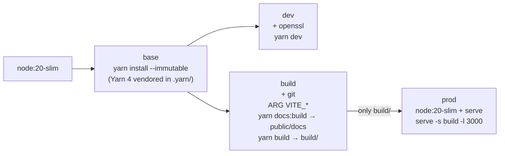

# Docker

How the frontend image is built and served. The image is meant to be run from
[USPolis-Admin](https://github.com/PCS-Poli-USP/USPolis-Admin), whose
`docker-compose.yml` passes the `VITE_*` values and puts it behind nginx. Its
`docs/DOCKER.md` covers the stack as a whole.

## Files

| File | What it does |
|------|--------------|
| [`../Dockerfile`](../Dockerfile) | Builds the image, with a `dev` and a `prod` target |
| [`entrypoint.sh`](entrypoint.sh) | `dev` only: creates the self-signed certificate Vite serves |
| [`../.dockerignore`](../.dockerignore) | Keeps `.git/`, `node_modules/`, build output, certificates, `.env*` and docs out of the build |

## Image stages



- **`dev`** runs the Vite dev server. In Compose, the source is mounted over
  the image, and `node_modules` stays the image's own (an anonymous volume), so
  edits apply without a rebuild.
- **`build`** compiles the VitePress docs first and moves them to
  `public/docs`, so the React build copies them into `build/docs`. `git` is
  installed only because VitePress's "last updated" runs `git log` and fails
  without the binary. Since `.git/` isn't in the build context, pages show no
  date.
- **`prod`** keeps only `build/` and the `serve` static server. Nothing from
  `node_modules` or the source ends up in it.

## `VITE_*` values are fixed at build time

Vite writes them into the JavaScript bundle. In `prod` they are build
arguments: changing one means rebuilding the image. Setting them as
environment variables on a running `prod` container has no effect.

| Argument | Example (production) |
|----------|----------------------|
| `VITE_APP_NAME` | `USPolis` |
| `VITE_USPOLIS_API_ENDPOINT` | `https://www.uspolis.com.br/api` |
| `VITE_REDIRECT_URI` | `https://www.uspolis.com.br/auth-callback` |
| `VITE_GOOGLE_AUTH_CLIENT_ID` | the production OAuth client ID |
| `VITE_USPOLIS_DOCS_URL` | `https://www.uspolis.com.br/docs` |
| `VITE_ENVIROMENT` | `production` (spelled without the "n", as in the code) |
| `VITE_OVERRIDE_AUTH` | `false` |

In `dev`, the same names are read at runtime instead, and `entrypoint.sh` only
creates `certs/` when `VITE_ENVIROMENT=development`.

## One image, two services

USPolis-Admin runs the `prod` image twice:

| Service | Command | Answers |
|---------|---------|---------|
| `frontend` | `serve -s build -l 3000` (the image default) | the React app; `-s` answers every unknown path with `index.html`, for client-side routes |
| `docs` | `serve build -l 3001` | `/docs/`, without `-s`, so a missing docs page is a real 404 |

So a new image reaches the docs only when `docs` is recreated too:
`docker compose up -d frontend docs`.

## Building it alone

From this repository's root:

```bash
docker build --target prod \
  --build-arg VITE_USPOLIS_API_ENDPOINT=https://www.uspolis.com.br/api \
  --build-arg VITE_REDIRECT_URI=https://www.uspolis.com.br/auth-callback \
  --build-arg VITE_USPOLIS_DOCS_URL=https://www.uspolis.com.br/docs \
  --build-arg VITE_ENVIROMENT=production \
  -t uspolis-frontend:prod .
```
